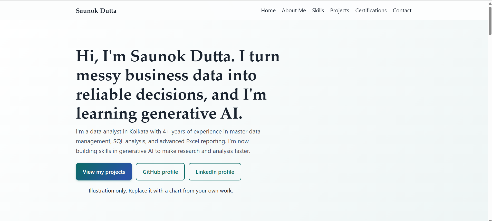

# AI-Powered Personal Introduction Website

A professional personal introduction website created using HTML and CSS with assistance from Generative AI.

## 🌐 Live Demo

**Website:** [[View My Website](https://saunokdutta12-cyber.github.io/ai-personal-introduction-website/)

## 📸 Website Preview



## 📌 Project Overview

This project demonstrates how Generative AI can assist beginners in creating a personal introduction website. The website presents my professional background, technical skills, projects, certifications, and learning journey.

## 🎯 Project Objectives

- Explore practical applications of Generative AI.
- Learn the fundamentals of HTML and CSS.
- Practice prompt engineering for code generation.
- Review, customize, and test AI-generated code.
- Build an online professional portfolio.

## 🛠️ Tools and Technologies

- HTML5
- CSS3
- Generative AI assistant
- GitHub
- GitHub Pages (if used for deployment)

## ✨ Key Features

- Personal introduction and About Me section
- Technical skills and areas of interest
- Projects and certifications
- Professional profile links
- Responsive design (if implemented)

## 🤖 Generative AI Workflow

1. Defined the website requirements.
2. Created prompts to generate code suggestions.
3. Reviewed and customized the HTML and CSS.
4. Tested the website in a browser.
5. Uploaded the project files to GitHub.
6. Published the website using GitHub Pages, if applicable.

## 📂 Project Structure

```text
ai-personal-introduction-website/
├── index.html
├── style.css
├── README.md
└── screenshots/
    └── homepage.png
```

*Adjust this structure to match your actual files.*

## ▶️ How to Run Locally

1. Download or clone this repository.
2. Open the project folder.
3. Open `index.html` in a web browser.

## 📚 Key Learnings

- Writing prompts for AI-assisted coding.
- Understanding HTML structure and CSS styling.
- Reviewing and testing AI-generated code.
- Documenting and publishing a project with GitHub.

## 🔮 Future Improvements

- Add JavaScript interactions.
- Improve accessibility and mobile responsiveness.
- Showcase additional SQL and Power BI projects.
- Expand the portfolio as I learn new technologies.

## 👨‍💻 Author

**Saunok Dutta**

Aspiring Data Analyst | Generative AI Learner | SQL | Python | Power BI

- LinkedIn: [Saunok Dutta](https://www.linkedin.com/in/saunokdutta/)
- GitHub: [Saunok Dutta](https://github.com/saunokdutta12-cyber)
